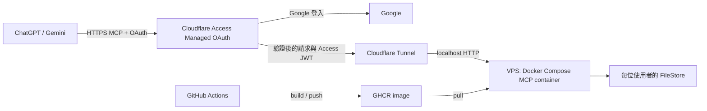

# Cloudflare Tunnel + Google 登入的 MCP 設定計劃

日期：2026-10-29
狀態：程式與自動測試已完成並通過本機檢查；部署至 VPS、設定 Cloudflare 與 ChatGPT／Gemini 真實連線尚未進行

## 目標

讓 ChatGPT 與 Gemini 使用公開的 Streamable HTTP MCP URL。MCP service 與各使用者資料保留在自己的主機，透過現有 Cloudflare Tunnel 提供 HTTPS，並沿用 Cloudflare Access 的 Google 登入與存取政策。

## 先確認的事

- Cloudflare Zero Trust 的既有 Google identity provider 能正常登入；確認帳戶可使用 self-hosted application 的 Managed OAuth。以新的 MCP hostname 和獨立 Access application 試行，避免影響現有服務。
- 確認 VPS 持續運作、已安裝 Docker Engine 與 Compose、`cloudflared` 可連到本機服務，並準備持久 volume、備份與足夠空間。Node.js 執行環境由 image 提供。
- 選定 MCP hostname，例如 `mcp.example.com`；實際網域、Tunnel 名稱與 Access team domain 由環境決定。不要把憑證、token 或使用者資料寫入 repo。
- 確認 ChatGPT 和 Gemini 的 OAuth client 註冊方式、精確 redirect URI、RFC 8707 支援與 Cloudflare DCR allowlist。不要根據範例猜測或放寬 redirect URI；先在各平台取得實際值。

## 核心設計

### 已確認的產品決定

- VPS 第一版為每位使用者建立空白帳本；既有 stdio 卡片、優惠與交易資料不在首次上線時自動遷移。未來如需匯入，另行設計資料歸屬確認、備份、`ownerUser` 轉換、衝突檢查與回復流程。
- 若 Cloudflare 使用者 `sub` 改變，管理者手動確認舊、新 principal 後，將新 principal 綁定至舊 tenant key，撤銷舊 principal，保留持久資料中的 `ownerUser` 和 idempotency key，不改寫歷史帳本。綁定與撤銷記錄備份在 `principal-bindings.json`；重新綁定前會建立完整備份。管理工具檢查身份衝突、既有帳本與 owner 欄位；不以 email 自動合併資料。
- 第一版保留每個 tenant 各自的 merchant catalog；原 `CONTEXT.md` 中部署共用 catalog 的描述依此決定更新。共享目錄另行規劃，本次不可將目前實作描述為已經共享。
- 現有 `cloudflared` 執行在 VPS 主機上；MCP container 透過僅綁定主機 loopback 的 port 提供服務給它。
- 第一版透過 Cloudflare Access policy 僅允許管理者指定的 Google 帳號登入；帳號清單在部署時設定與管理，不放入 repo。
- GHCR image 採 Public，讓 VPS 可匿名拉取；GitHub repository 目前也是 Public。首次發佈後確認 package 實際可見性與 repository 關聯；image 不包含憑證或使用者資料。
- GitHub Actions 在 feature branch、`main` 與版本 tag 推送時發佈 image；feature branch 和 commit SHA tag 供測試，`main` 更新 `latest`，版本 tag 提供正式版本。正式 VPS 固定使用版本 tag 或 digest。
- 第一版由管理者手動執行備份指令，每次備份整個 MCP 資料目錄（包含所有 tenant），產生帶時間標記的備份並保留在 VPS 本機。備份與身份重新綁定操作會先停止 MCP container，並在完成後依原狀恢復服務；部署 wrapper 也會在拉取及啟動新 image 前建立完整備份。操作會使用同一 SSH 帳號下依 volume 名稱識別的鎖，並驗證沒有第二個運作中的 container 使用該 volume。成功備份後預設保留最近 7 份；備份失敗不觸發清理。全量與單一 tenant 還原均不合併、需明確確認並先備份現況；全量還原若會改變 principal mapping，需再確認可能恢復舊身份存取權。此備份可用於部分操作失誤或資料復原，但若 VPS 或儲存裝置遺失，本機資料與備份可能一同遺失；自動排程與異地備份不列入第一版。
- 第一版提供整個服務以及單一使用者兩種還原方式；單一使用者還原不得改動其他 tenant 的帳本。還原前須停止服務、備份現況，並由管理者確認備份版本及目標。單一使用者還原以備份完整取代該 tenant 現有帳本，不合併記錄；備份後新增的交易會回退。完成後驗證並重新啟動；若需撤銷，以還原前的備份復原。

Managed OAuth 在未認證的非瀏覽器請求回傳 OAuth challenge；使用者透過既有 Google IdP 登入。Cloudflare 發給 client 的 access token 是 **opaque token**，Cloudflare 驗證後向 origin 轉送簽章 Access assertion。MCP service 驗證 `Cf-Access-Jwt-Assertion`，而非將 client 的 opaque token 當作 JWT 解碼。[Cloudflare Managed OAuth](https://developers.cloudflare.com/cloudflare-one/access-controls/applications/http-apps/managed-oauth/)

這與目前 `src/http-auth.ts` 不同：現有模式驗證 `Authorization: Bearer` JWT、MCP URL audience、scope 和 issuer 自訂 user-grant marker。新增明確的 Cloudflare Access 認證模式；保留現有模式作為獨立設定，不能將兩者的驗證條件混用。Managed OAuth 會改寫受保護 application 的 401 行為，不能期待同一條路徑同時由現有 MCP OAuth discovery 主導。[Cloudflare Managed OAuth 注意事項](https://developers.cloudflare.com/cloudflare-one/access-controls/applications/http-apps/managed-oauth/)

Access 模式使用固定設定的 team issuer、Cloudflare 公開 JWKS 與 application AUD tag 驗證 assertion 簽章、issuer、audience、expiry 及必要 claim；缺失、無效、過期或屬於另一個 application 均拒絕。不得信任未驗證的 email、header 或工具參數。以已驗證 issuer 和穩定的個人 subject 對應 tenant；若實際 assertion 不含可確認的個人 subject，停止並確認 Cloudflare 身分語義，不以 email 或 service token 代替。Cloudflare 公開金鑰會輪替，驗證器需要支援更新。[Cloudflare Access JWT 驗證](https://developers.cloudflare.com/cloudflare-one/access-controls/applications/http-apps/authorization-cookie/validating-json/)

驗證時需確認為 application token 且 subject 是非空的個人身分，拒絕 service-token 身分。Cloudflare 說明使用者移除後重新加入 Zero Trust 組織或改用其他組織時 `sub` 可能改變，需使用管理者復原流程。[Cloudflare application token](https://developers.cloudflare.com/cloudflare-one/access-controls/applications/http-apps/authorization-cookie/application-token/)

## FileStore 與單一 process

第一版採 **一個 VPS、單一 container、單一 Node.js process**。多位使用者共用同一個 HTTP process，每位使用者仍有各自的 tenant 目錄和 FileStore；同一 tenant 在 process 內只建立一個共用 store instance。水平擴充和多個 process 同時使用同一資料根目錄不在第一版範圍。

重新設計 FileStore 的寫入協調：同一 tenant 的更新必須完整且依序完成；現有 `update()` 是同步操作，單一 Node.js process 內不會在同步操作中插入另一個請求。若改為非同步寫入，須在 store 內增加每個 tenant 的 queue 或 mutex。保留先寫暫存檔再重新命名的策略，以及持久化資料的備份與還原。

HTTP 單 process 模式不使用目前以 PID 判斷持有者存活的 lock file 機制，避免 container 重建後 PID 重複造成無法重啟；同一 process 不允許重複建立相同目錄的 FileStore。stdio 原有 lock file 行為保留。**記憶體內協調無法阻止另一個 process 或 container 開啟同一資料目錄**：部署者必須確保只有一個 owner，避免手動啟動第二份服務或與 stdio process 共用 tenant 目錄。管理與更新 wrapper 會停下 MCP、確認沒有第二個運作中 container，並以同一 SSH 帳號下依 volume 命名的 `flock` 序列化受支援的操作；直接使用 Docker 或其他帳號仍可繞過此鎖。未來需要多個 instance 時，先改用具備跨 process 協調能力的持久化方案。

## 實施順序

1. **盤點與隔離試行（待部署）**：尚未新增 Cloudflare Tunnel route 或 Access application。部署時先確認既有 Tunnel、Google IdP、Access policy、hostname 與主機環境；新增測試 hostname／application，不改動既有服務。
2. **程式調整（已實作，待最終 review）**：新增明確的 `cloudflare-access` 身分驗證 adapter；將驗證後 principal 接入現有 tenant registry 和 28 個共用 tools；HTTP 使用單 process store，stdio 保留 PID lock。採 container `0.0.0.0` listen 和 VPS `127.0.0.1` publish；Cloudflare 模式只信任已驗證的 Access assertion。
3. **建置與發佈 image（已實作，待 CI 實際成功）**：已新增 Dockerfile、Compose 與 GitHub Actions verify→publish workflow；首次推送後須確認 GHCR package 的 Public visibility 與 VPS 架構相容。
4. **建立 VPS container**：以 Docker Compose 從 GHCR 拉取指定版本，設定固定 localhost port、持久資料 volume、Cloudflare team issuer、JWKS 和測試 application AUD。先在 VPS 本機確認服務啟動及未帶有效 assertion 的請求被拒絕。
5. **設定 Tunnel**：在現有 Tunnel 新增 hostname 對應 `http://127.0.0.1:<port>`，公開 MCP URL `https://<hostname>/mcp`。MCP 使用 SSE 時需保留 `Content-Type: text/event-stream`；Cloudflare 說明此 header 可避免 Tunnel 緩衝串流。[Tunnel 串流說明](https://developers.cloudflare.com/tunnel/troubleshooting/)
6. **設定 Access**：建立測試用 self-hosted Access application，指定 MCP hostname、Google IdP 與允許的使用者或群組。確認程式已支援並驗證 Access JWT 後，在 Advanced settings 啟用 Managed OAuth；設定必要的 client 註冊和 redirect URI。Cloudflare 文件建議短 access token lifetime 配較長 grant session，實際值依使用者需求決定。[Managed OAuth 設定](https://developers.cloudflare.com/cloudflare-one/access-controls/applications/http-apps/managed-oauth/)
7. **驗證 discovery 與工具**：確認未登入 MCP 請求得到 `401` 和可用的 `WWW-Authenticate` discovery，而非一般登入頁 `302`；確認 metadata、授權碼 + PKCE 和實際 callback；再驗證 initialize、`tools/list`、讀取及經使用者確認的寫入。檢查 SSE 和長連線行為。
8. **驗證使用者隔離**：使用兩個不同 Google 身分；A 建立資料後，B 的讀取結果不含 A 資料、無法修改 A 資料；切回 A 後資料仍存在。用同一 Google 身分分別從 ChatGPT 和 Gemini 登入，確認兩端取得同一穩定 principal；如不同，先停止並設計帳號對應，避免意外分成兩份帳本。
9. **正式切換**：完成驗證後記錄正式 hostname、AUD、資料位置、備份及回復步驟；由管理者將測試 Access policy 和 Tunnel 設定套用到正式服務。

## Docker 與 GHCR

### Image 建置

- 新增多階段 `Dockerfile`：以鎖定的 npm dependencies 編譯 TypeScript，runtime image 只放執行所需檔案與 production dependencies；使用非 root 使用者執行 HTTP MCP。
- 新增 `.dockerignore`，排除 `.git`、本機 `.env`、資料目錄、`node_modules` 和其他不需要的內容。image 不包含憑證或使用者資料。
- 確認 VPS 是 `linux/amd64` 或 `linux/arm64`；建議 workflow 建置兩種架構，並以實際 VPS 拉取確認。

### GitHub Actions → GHCR

- 在同一 workflow 設定 `verify` → `publish` 的 job dependency，或使用可證明檢查對應同一 commit 的 gate；不能假設另一個獨立 CI workflow 已成功。
- 新增獨立 workflow，使用 `GITHUB_TOKEN`、`contents: read`、`packages: write` 發佈至 `ghcr.io/acetaxxxx/taiwan-card-rewards-mcp`。不需將個人 GHCR token 放進 repository secrets；首次建立 package 後確認 repository 的 package 權限與可見性。[GitHub Packages 文件](https://docs.github.com/en/packages/managing-github-packages-using-github-actions-workflows/publishing-and-installing-a-package-with-github-actions)
- 建議 branch push 建置並發佈可辨識的 branch／commit SHA tag 供測試；`main` 更新 `latest`，版本 tag 產生對應 release tag。PR 可建置但不發佈；正式 VPS 固定使用版本 tag 或 image digest，而非自動跟隨 `latest`。
- 在發佈前執行專案的 typecheck、build 與測試；image 建置失敗或檢查未通過不得推送。使用 image source label 將 GHCR package 連到 repository。[GitHub Container registry 文件](https://docs.github.com/en/packages/working-with-a-github-packages-registry/working-with-the-container-registry)

### VPS Compose

- 新增 `compose.yaml`，由 GHCR `image:` 拉取指定版本；容器設 `restart: unless-stopped`，只有一個 MCP service instance。container 對外 listen，VPS 只發佈 `127.0.0.1:<host-port>:<container-port>`，讓同主機的 `cloudflared` 連接。若 `cloudflared` 也在 container，需另行指定共用 Docker network 與 service address，不能假設兩個 container 的 `localhost` 相同。
- 用 named volume 或明確的 VPS bind mount 保存 MCP 資料；確保 container 使用者有讀寫權限。image 更新、container 重建與重啟不得刪除該 volume；不要使用 `docker compose down -v` 清除正式資料。
- 非 root container 使用者必須擁有資料根目錄，因目前啟動程式會設定該目錄權限；需明確設計 volume 初始化及權限驗證。runtime image 保留 `package.json` 供服務讀取版本。`/healthz` 位於 Host 驗證之後，健康探針需使用允許的 Host。
- 提供 `.env.example` 和部署說明：包含 image tag、公開 MCP URL、Cloudflare Access issuer／AUD／JWKS 等實作完成後的實際設定名稱。VPS 的 `.env` 不提交 Git；不在 workflow、image、log 或計劃書中放 token。現有服務仍是 Bearer JWT 模式，Cloudflare Access adapter 完成前不可宣稱這份設定可直接登入。
- 日常更新：固定新的 image tag／digest → `scripts/mcp-admin.sh deploy`（使用 per-volume lock、先備份、pull、啟動和等待 health）→ 實際 Tunnel 登入驗收。失敗時設定上一個 image tag 再透過相同 wrapper 更新；不得同時執行新舊 container。若新版本有不可逆資料 migration，先確認相容性，不能假設舊 image 可以直接讀取。

### 額外驗證

- 驗證 Compose 設定可解析、image 可在目標架構啟動，主機只從 loopback 開放服務；驗證容器重建後資料仍在。
- 確認 GHCR package 首次發佈後為 Public，且 VPS 可以匿名拉取指定 image；若實際權限與預期不符，先修正 package 設定再部署。
- 不要讓 GitHub Actions 自動部署或修改既有 VPS、Tunnel、Access policy；本次 workflow 負責 image 建置與發佈，部署由管理者執行。

## 測試與完成條件

- 自動測試已涵蓋 assertion 不存在、偽造、過期、issuer／AUD 錯誤、缺 subject、金鑰輪替，以及兩位使用者隔離；既有 OAuth token 與 stdio 測試保留。新增的備份、還原、重新綁定及 FileStore 案例列於 `.scratch/cloudflare-tunnel/test-cases.md`，結果以最終 CI 為準。
- 真實 Tunnel 上驗證 MCP discovery、ChatGPT 和 Gemini 的 OAuth client 註冊、Google 登入、重新整理 token、工具清單與代表性工具呼叫。對 Gemini 帳戶資格及介面以實際可用情況為準。
- 確認外部直接連到 origin 無法繞過身份驗證，且不會在 log 中保存 token。驗證程序不輸出個人資料或原始憑證。
- 一個 service process 持有資料根目錄；停止後能正常重啟並讀回資料。單元測試和容器 smoke test 已涵蓋部分備份、還原、health 與 volume 保留行為；正式使用前仍須在目標 VPS 驗證完整流程。
- 驗證同一 tenant 的並行請求更新不會互相覆寫、不同 tenant 資料隔離，以及 process 強制終止後重新建立 container 能讀回最後成功寫入的資料。驗證部署流程在啟動新版本前已停止舊版本；第一版的 process 內協調不提供雙 process 保護。

## 風險與備案

- **Managed OAuth 相容性**：Cloudflare 文件支援 DCR，但各 client 的具體 redirect URI、scope、RFC 8707 與 PKCE metadata 需實測。先用測試 hostname 驗證；若某個 client 無法連接，保留原 Bearer JWT OAuth adapter，另評估 MCP portal 或獨立 OAuth provider。
- **身份穩定性**：不同 application 或 IdP 設定可能產生不同 subject；確認前不宣稱跨 ChatGPT／Gemini 共用帳本。若變更 issuer 或 subject，原 hash 目錄不會自動遷移。
- **主機可用性**：主機或 Tunnel 停止時 MCP 無法使用。FileStore 為單 process 設計，不能讓多個 replica 共寫；需要持久磁碟、備份及恢復程序。
- **回復**：測試使用獨立 hostname／Access application。遇到問題停止測試 service、移除測試 route 或停用測試 application；保留資料目錄與既有服務。正式切換時先保存原設定，避免覆寫既有 Access policy。

## 參考來源

- [Cloudflare Managed OAuth](https://developers.cloudflare.com/cloudflare-one/access-controls/applications/http-apps/managed-oauth/)
- [Cloudflare Secure MCP servers](https://developers.cloudflare.com/cloudflare-one/access-controls/ai-controls/secure-mcp-servers/)
- [Cloudflare Access JWT 驗證](https://developers.cloudflare.com/cloudflare-one/access-controls/applications/http-apps/authorization-cookie/validating-json/)
- [Cloudflare MCP portal](https://developers.cloudflare.com/cloudflare-one/access-controls/ai-controls/mcp-portals/)
- [ChatGPT MCP OAuth](https://developers.openai.com/plugins/build/auth)
- [Gemini OAuth 指引](https://developers.google.com/connected-apps/mcp/oauth)
